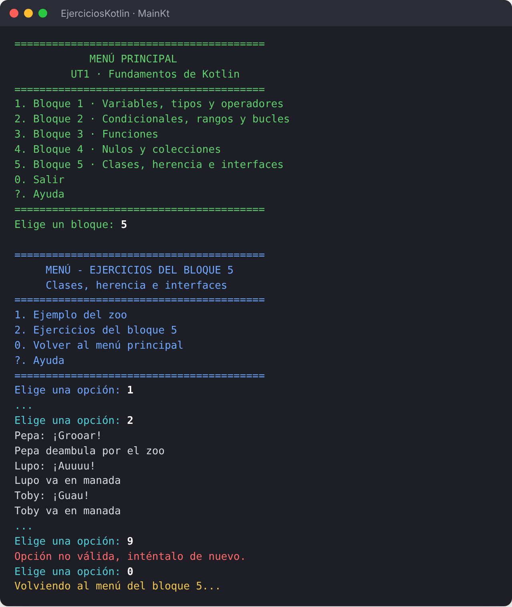
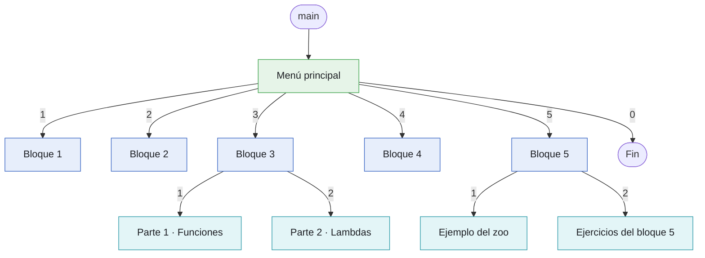
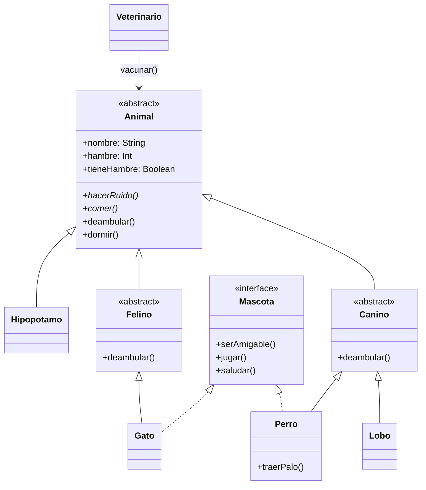

<div align="center">

# 🟣 EjerciciosKotlin

### UT1 · Fundamentos de Kotlin

Aplicación de consola con los ejercicios resueltos de la **UT1** del módulo<br>
*Desarrollo de Interfaces* · 2º DAM · IES Virrey Morcillo

[](https://kotlinlang.org/)
[](https://learn.microsoft.com/java/openjdk/)
[](https://www.jetbrains.com/idea/)


[**Cómo ejecutarlo**](#-cómo-ejecutarlo) ·
[**Contenido**](#-contenido) ·
[**Estructura**](#-estructura-del-proyecto) ·
[**Documentación**](#-documentación)



</div>

---

## ✨ Qué es

Un único programa con menús desde el que se ejecuta cualquier ejercicio de la unidad. Eliges el bloque, después el ejercicio, y al terminar vuelves al menú, sin tener que arrancar nada otra vez.

- 🧭 **Menús por colores**: verde el principal, azul los de bloque y cian los submenús.
- ❓ **Ayuda en cada menú**: escribe `?` y verás qué hace cada opción.
- 🛡️ **Entradas a prueba de errores**: un texto donde se espera un número nunca detiene el programa.
- 📚 **Todo documentado con KDoc**, con una [página de la API](docs/api/index.html) generada a partir de los comentarios.

## 📦 Contenido

| | Bloque | Qué se practica | Ejercicios |
|:-:|---|---|:-:|
| 1️⃣ | **Variables, tipos y operadores** | `val` y `var`, tipos básicos, operadores, plantillas de cadena | 6 |
| 2️⃣ | **Condicionales, rangos y bucles** | `if` y `when` como expresiones, rangos, `for`, `while`, `do-while` | 6 + reto |
| 3️⃣ | **Funciones** · parte 1 | Parámetros, valores por defecto, argumentos con nombre, retornos anticipados | 6 + 2 retos |
| 3️⃣ | **Expresiones lambda** · parte 2 | Tipos de función, funciones de orden superior, `it`, lambdas finales | 6 + reto |
| 4️⃣ | **Nulos y colecciones** | `?.`, `?:`, `toIntOrNull()`, listas, conjuntos y mapas | 6 + reto |
| 5️⃣ | **Ejemplo del zoo** | La jerarquía `Animal` → `Canino` / `Felino` y la interfaz `Mascota` del ejemplo de Java, en Kotlin | 6 opciones |
| 5️⃣ | **Clases, herencia e interfaces** | `init`, getters y setters, `open`, `abstract`, `interface`, `data class`, `enum class`, `object`, `companion object` | 6 + reto |

<details>
<summary><b>Ver todos los ejercicios</b></summary>
<br>

| Bloque | Ejercicios |
|---|---|
| **1** | Preséntate · ¿val o var? · Encuentra los errores · Conversor de temperatura · Calculadora de precio · Recibo del presupuesto |
| **2** | Gastos de envío · De nota a calificación · Tabla de multiplicar · Predice la salida · Mes del año · Mes y estación · 🏆 Adivina el número |
| **3 · parte 1** | Saludos · Conversor de unidades · Generador de nombres de usuario · Cláusulas de guarda · Encuentra los errores · Calculadora de productos · 🏆 Mes y estación · 🏆 Adivina el número |
| **3 · parte 2** | De función a lambda · Ponle nombre al tipo · Calculadora con lambdas · Analizador de textos · Tu propio repeat · Predice la salida · 🏆 Reglas de descuento |
| **4** | Entrada segura · Predice la salida · Agenda de contactos · Análisis de notas · Visitantes únicos · Lista de productos · 🏆 Tienda con stock |
| **5 · zoo** | Censo del zoo · Ruidos y paseos · Hora de comer · Visita del veterinario · Hora de jugar · Paseo con el perro |
| **5 · ejercicios** | Tu primera clase · Setter con validación · Encuentra los errores · Instrumentos · Aves · Fichas del refugio · 🏆 Refugio de animales |

</details>

## 🚀 Cómo ejecutarlo

**Requisitos:** JDK 21 (sirve cualquier JDK 17 o superior) e IntelliJ IDEA con el plugin de Kotlin, que viene de serie. El proyecto es un módulo de IntelliJ, sin Gradle.

1. Clona el repositorio o descárgalo con **Code → Download ZIP**:
   ```bash
   git clone https://github.com/ccnl10/EjerciciosKotlin.git
   ```
2. En IntelliJ, abre la carpeta `EjerciciosKotlin` con **File → Open**.
3. Abre `src/Main.kt` y pulsa el ▶ verde junto a `fun main()`.
4. Escribe el número de una opción y pulsa Intro. Con `?` ves la ayuda y con `0` vuelves al menú anterior.

> [!TIP]
> Para ejecutarlo fuera de IntelliJ, genera un `.jar` (los pasos están en el [manual técnico](docs/Manual_Tecnico_EjerciciosKotlin.pdf)) y, en Windows:
> ```bat
> chcp 65001
> java -jar EjerciciosKotlin.jar
> ```
> `chcp 65001` hace que las tildes y la ñ se vean bien. Usa **Windows Terminal**: el cmd clásico de Windows 10 muestra los colores como texto (`←[32m`).

## 🧭 Navegación



Todos los menús son un bucle `do-while` que termina con la opción **0**. Para volver, el menú no llama al anterior: simplemente termina, así que nunca se acumulan menús abiertos.

## 🦁 El ejemplo del zoo

El bloque 5 traslada a Kotlin el ejemplo de herencia que se vio en Java:



```kotlin
class Perro(nombre: String) : Canino(nombre), Mascota {   // una clase con (), las interfaces sin ()
    override fun hacerRuido() = println("$nombre: ¡Guau!")
    override fun jugar() = println("$nombre persigue la pelota")
    // ...
}
```

## 🗂️ Estructura del proyecto

<details>
<summary><b>Ver el árbol de carpetas</b></summary>

```text
EjerciciosKotlin/
├── README.md
├── docs/
│   ├── api/index.html            Documentación de la API (desde KDoc)
│   ├── img/                      Imágenes del README
│   ├── Manual_Tecnico_EjerciciosKotlin.docx / .pdf
│   └── Manual_Usuario_EjerciciosKotlin.docx / .pdf
└── src/
    ├── Main.kt                   main() y menú principal
    ├── Utilidades/               Colores.kt · Ayuda.kt
    ├── Bloque1/                  MenuB1 · EjerciciosB1
    ├── Bloque2/                  MenuB2 · EjerciciosB2
    ├── Bloque3/                  MenuB3 · MenuB3_1/_2 · EjerciciosB3_1/_2 · FuncionesB3_1/_2
    ├── Bloque4/                  MenuB4 · EjerciciosB4 · FuncionesB4
    └── Bloque5/
        ├── MenuB5.kt
        ├── EjemploZooB5/         Animal · Caninos · Felinos · Hipopotamo · Mascota
        │                         Veterinario · MenuZooB5 · OpcionesZooB5
        └── EjerciciosB5/         MenuEjerciciosB5 · EjerciciosB5 · Cachorro · Pez
                                  Errores · Instrumentos · Aves · Especies
                                  AnimalesRefugio · Refugio
```

</details>

El código está organizado en capas, de modo que cada archivo tiene un solo papel:

| Capa | Archivos | Papel |
|---|---|---|
| 🧭 Navegación | `Main.kt`, `Menu*.kt` | Pintan el menú, leen la opción y llaman al ejercicio |
| ✏️ Ejercicios | `Ejercicios*.kt`, `OpcionesZooB5.kt` | Piden los datos y muestran el resultado |
| ⚙️ Lógica y modelo | `Funciones*.kt` y las clases del bloque 5 | Cálculos, colecciones y objetos |
| 🎨 Utilidades | `Colores.kt`, `Ayuda.kt` | Colores, avisos, errores y ayuda comunes a todos los menús |

### 🎨 Colores de la consola

| Color | Dónde |
|---|---|
| 🟢 Verde | Menú principal |
| 🔵 Azul | Menús de bloque |
| 🩵 Cian | Submenús (bloques 3 y 5) |
| 🟡 Amarillo | Avisos y ayuda |
| 🔴 Rojo | Errores |

## 📚 Documentación

| Documento | Para quién | Contenido |
|---|---|---|
| 📘 [Manual de usuario](docs/Manual_Usuario_EjerciciosKotlin.pdf) | Alumnado | Cómo se usa el programa, con un ejemplo de cada ejercicio |
| 🛠️ [Manual técnico](docs/Manual_Tecnico_EjerciciosKotlin.pdf) | Quien mantenga o amplíe el proyecto | Arquitectura, decisiones de diseño, modelo de clases, distribución y cómo añadir un bloque |
| 🔎 [API](api) | Programadores | Cada función, clase y propiedad, con buscador y enlaces |


## ➕ Añadir un bloque nuevo

1. Crea el paquete `BloqueN` con `EjerciciosBN.kt` (y `FuncionesBN.kt` si hay lógica reutilizable).
2. Crea `MenuBN.kt` copiando `MenuB4.kt`, con su función de ayuda. La opción de volver es siempre `0`.
3. En `Main.kt`: importa `BloqueN.menuBloqueN`, añade la opción al menú y al `when`, y una línea en `ayudaMenuPrincipal()`.
4. Documenta las declaraciones nuevas con KDoc.

---

<div align="center">
<sub>Desarrollo de Interfaces · 2º DAM · IES Virrey Morcillo (Villarrobledo) · Curso 2026-2027</sub>
</div>
